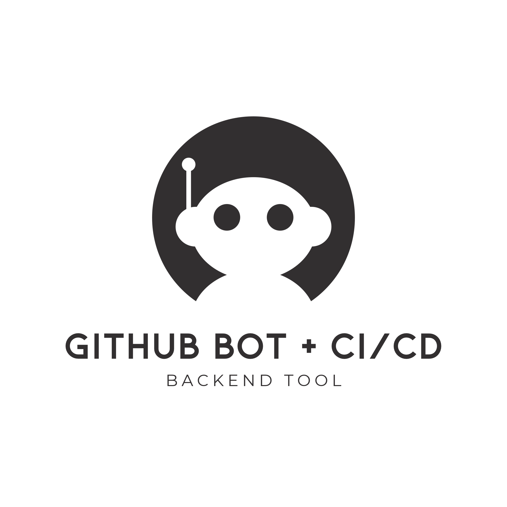

<div align="center">



# GitHub Bot + CI/CD

**An open-source GitHub automation tool that integrates CI/CD workflows with AI-powered pull request reviews, summaries, and build failure analysis.**

Developed and maintained by the **SFU Open Source Development Club (OS DEV)**.

</div>

---

## About the Project

GitHub Bot + CI/CD is an open-source developer automation project designed to streamline software development workflows using GitHub Actions and Large Language Models (LLMs).

The project aims to automate repetitive development tasks, including pull request summaries, code review assistance, issue management, automated testing, and CI/CD pipeline monitoring.

By integrating GitHub's automation capabilities with an LLM API, the system will help developers better understand code changes, identify potential issues, and diagnose build failures.

Unlike traditional full-stack web applications, this project does not require a separate frontend. GitHub's existing Pull Request, Issues, and Actions interfaces serve as the primary user interface.

The project is part of the **SFU OS DEV Fall 2026 Open Source Project Initiative**, providing students with hands-on experience in DevOps, CI/CD, backend automation, GitHub API integration, and AI-assisted software engineering.

**Project Status:** Early Development — Planning & Initial Setup

## Key Features

The following features are planned for development:

| Feature | Description | Status |
|---|---|---|
| Pull Request Summarization | Automatically summarize code changes in Pull Requests using an LLM | Planned |
| AI-Assisted Code Review | Analyze code changes and provide suggested improvements | Planned |
| Inline Review Comments | Post contextual review comments on relevant lines of code | Planned |
| Automated CI Checks | Run automated tests, builds, and validation workflows | Planned |
| Build Failure Explanation | Analyze failed workflow logs and generate understandable explanations | Planned |
| PR & Issue Automation | Automate routine Pull Request and Issue management tasks | Planned |
| CI/CD Pipeline Integration | Integrate build, test, and deployment stages into GitHub Actions | Planned |

Additional automation features may be proposed and implemented by project contributors.

## Tech Stack

| Category | Technologies |
|---|---|
| Runtime | Node.js |
| Programming Language | JavaScript / TypeScript |
| Automation | GitHub Actions |
| Framework | GitHub Actions Toolkit (`@actions/core`, `@actions/github`) |
| Configuration | YAML |
| GitHub Integration | GitHub REST API / Octokit |
| AI Integration | LLM API |
| Testing | Jest or Vitest (To Be Determined) |
| Version Control | Git, GitHub |
| CI/CD | GitHub Actions |

The final LLM provider, testing framework, and implementation details will be determined by the project team.

## Project Architecture

The application follows an event-driven architecture using GitHub Actions.

```text
                  GitHub Repository
                          |
                          v
                    GitHub Event
                 (PR, Issue, Push)
                          |
                          v
                  GitHub Actions
                          |
                 +--------+--------+
                 |                 |
                 v                 v
            CI/CD Workflow     Automation Bot
                 |                 |
          +------+------+    +-----+------+
          |             |    |            |
          v             v    v            v
        Build          Test  GitHub API   LLM API
          |             |    |            |
          +------+------+    +-----+------+
                 |                 |
                 v                 v
            CI Results       AI Analysis
                 |                 |
                 +--------+--------+
                          |
                          v
                GitHub Pull Request
               (Checks and Comments)
```

### Component Responsibilities

**GitHub Actions**
- Trigger workflows based on GitHub events.
- Execute automated build and test jobs.
- Run the custom GitHub automation bot.
- Report workflow results.

**GitHub Bot**
- Retrieve Pull Request information.
- Inspect changed files and commit metadata.
- Process GitHub webhook event payloads.
- Interact with GitHub APIs.
- Post summaries and review comments.

**LLM Integration**
- Generate summaries of Pull Request changes.
- Provide code review suggestions.
- Explain relevant CI/CD failures.
- Produce structured analysis results.

**CI/CD Pipeline**
- Install dependencies.
- Build application code.
- Execute automated tests.
- Validate pull requests.
- Support deployment workflows when configured.

## Repository Structure

The planned repository structure is:

```text
github-bot-cicd/
├── assets/
│   └── github-bot-cicd-logo.png
│
├── src/
│   ├── index.ts
│   ├── github/
│   │   ├── pull_requests.ts
│   │   ├── issues.ts
│   │   └── comments.ts
│   ├── llm/
│   │   ├── client.ts
│   │   ├── summarizer.ts
│   │   └── reviewer.ts
│   ├── ci/
│   │   ├── build_analyzer.ts
│   │   └── test_analyzer.ts
│   └── utils/
│       └── logger.ts
│
├── tests/
│   ├── github.test.ts
│   ├── summarizer.test.ts
│   └── reviewer.test.ts
│
├── docs/
│   ├── architecture.md
│   ├── setup.md
│   └── workflows.md
│
├── .github/
│   ├── workflows/
│   │   ├── ci.yml
│   │   └── bot.yml
│   ├── ISSUE_TEMPLATE/
│   └── pull_request_template.md
│
├── action.yml
├── package.json
├── tsconfig.json
├── .env.example
├── .gitignore
├── CONTRIBUTING.md
├── LICENSE
└── README.md
```

This structure represents the intended architecture and may change during development.

## Getting Started

We welcome contributors interested in DevOps, backend development, automation, AI integration, and software engineering.

### Prerequisites

The planned development environment requires:

- Git
- Node.js and npm
- Visual Studio Code or another preferred IDE
- A GitHub account
- Basic familiarity with Git and GitHub
- Familiarity with YAML (recommended)
- Access to an LLM API for applicable integration tasks (optional during initial development)

### 1. Fork the Repository

Visit the official SFU OS DEV repository:

https://github.com/sfuosdev/github-bot-cicd

Click **Fork** to create a copy under your personal GitHub account.

### 2. Clone Your Fork

```bash
git clone https://github.com/YOUR_USERNAME/github-bot-cicd.git
cd github-bot-cicd
```

Replace `YOUR_USERNAME` with your GitHub username.

### 3. Configure Upstream

```bash
git remote add upstream https://github.com/sfuosdev/github-bot-cicd.git
```

Verify:

```bash
git remote -v
```

### 4. Install Dependencies

Once the initial Node.js project has been configured:

```bash
npm install
```

Dependencies and their versions will be maintained in `package.json` and the project's lockfile.

### 5. Run Tests

Once the testing framework and scripts are implemented:

```bash
npm test
```

### 6. Run the Bot Locally

The project will provide a development workflow for testing GitHub event handlers using sample event payloads and mocked GitHub API responses.

Actual execution commands will be added to `docs/setup.md` once the starter codebase is implemented.

**Note:** The repository is currently in early development. Installation commands, workflow files, and automation features must be implemented and verified before they are considered operational.

## GitHub Actions Integration

GitHub Actions will serve as the primary execution environment.

### Planned Workflow Triggers

| Event | Planned Behavior |
|---|---|
| `pull_request` | Run CI checks and generate PR summaries |
| `issues` | Perform selected Issue automation tasks |
| `push` | Execute automated build and test workflows |
| `workflow_run` | Analyze completed CI workflows and selected failures |
| `workflow_dispatch` | Allow authorized users to trigger manual workflows |

Trigger configuration and permissions will be finalized during implementation.

### Example Workflow Configuration

The following is a minimal example of a CI workflow. It is intended as a starting reference and is not yet a complete project workflow.

```yaml
name: Continuous Integration

on:
  pull_request:
  push:
    branches:
      - main

permissions:
  contents: read

jobs:
  test:
    runs-on: ubuntu-latest

    steps:
      - name: Checkout repository
        uses: actions/checkout@v4

      - name: Setup Node.js
        uses: actions/setup-node@v4
        with:
          node-version: "22"

      - name: Install dependencies
        run: npm ci

      - name: Run tests
        run: npm test

      - name: Build project
        run: npm run build
```

This example assumes the project provides a lockfile and the corresponding npm scripts.

Production workflows should use reviewed, pinned action versions and follow the principle of least privilege.

## AI-Powered Pull Request Summarization

One of the planned core features is automatic Pull Request summarization.

### Proposed Workflow

1. A developer submits a Pull Request.
2. GitHub Actions triggers the automation bot.
3. The bot retrieves changed files and relevant PR metadata.
4. The changes are processed into an LLM-compatible input.
5. The LLM generates a structured summary.
6. The bot posts the summary as a Pull Request comment.

### Example Summary Output

**Pull Request: Add API Usage Tracking**

**Summary**
- Introduces a new REST API endpoint for token usage records.
- Adds request validation.
- Includes basic unit tests.

**Files Changed**
- `src/api/usage.ts`
- `src/models/usage.ts`
- `tests/usage.test.ts`

**Suggested Review Areas**
- Input validation
- Error handling
- Test coverage

The exact summary format will be determined during implementation.

## AI-Assisted Code Review

The bot will eventually support automated code review assistance.

Potential capabilities include:

- Identifying potential logic errors
- Suggesting improvements to code readability
- Highlighting missing error handling
- Identifying potentially insufficient test coverage
- Explaining code changes to reviewers
- Providing contextual inline review comments

AI-generated suggestions are advisory and must not replace human code review.

The bot should avoid posting excessive, repetitive, or low-confidence comments.

## Build Failure Analysis

The project will explore methods for analyzing failed CI workflows.

### Proposed Workflow

1. A CI workflow fails.
2. The bot receives an authorized workflow completion event.
3. Relevant logs and failure metadata are retrieved.
4. Error output is filtered and prepared for analysis.
5. An LLM generates an explanation of the likely failure.
6. The bot posts a summary with potential debugging suggestions.

### Example Failure Explanation

**CI Workflow Failed**

**Failed Step:** Install Dependencies

**Error Category:** Dependency Resolution

**Possible Cause:**
A required package version may be unavailable or incompatible with the current dependency configuration.

**Suggested Investigation:**
- Review the dependency lockfile.
- Inspect the failing package version.
- Reproduce the failure locally.

The bot should distinguish observed errors from inferred causes rather than presenting uncertain diagnoses as facts.

## Security & Permissions

GitHub Actions and LLM integrations require careful security practices.

All contributors must follow these principles:

- Never commit GitHub tokens, API keys, or passwords.
- Store sensitive credentials in GitHub Actions Secrets.
- Grant workflows only the permissions required for their tasks.
- Avoid exposing credentials to untrusted Pull Request code.
- Treat PR descriptions, code changes, Issue comments, and logs as untrusted input.
- Limit the size and scope of content sent to LLM providers.
- Do not transmit sensitive repository data to external APIs without authorization.
- Avoid executing untrusted code with privileged GitHub tokens.
- Review all automation permissions before enabling them on organization repositories.

The project should initially be tested in a dedicated sandbox repository.

Workflows handling untrusted Pull Requests must not receive privileged secrets. Any separate privileged commenting or analysis workflow must treat artifacts and logs as untrusted data, validate its inputs, and avoid executing attacker-controlled content.

The bot should not automatically approve or merge code based solely on LLM output.

## Development Roadmap

### Phase 1 — Project Initialization

- [ ] Initialize Node.js and TypeScript environment
- [ ] Install GitHub Actions Toolkit
- [ ] Establish repository structure
- [ ] Configure unit testing
- [ ] Create basic GitHub Actions CI workflow
- [ ] Prepare a dedicated test repository

### Phase 2 — GitHub API Integration

- [ ] Configure GitHub API client
- [ ] Retrieve Pull Request metadata
- [ ] Retrieve changed files
- [ ] Implement basic PR commenting
- [ ] Handle GitHub event payloads
- [ ] Add automated tests using mocked API responses

### Phase 3 — Pull Request Automation

- [ ] Build a PR change summarization module
- [ ] Integrate an LLM API
- [ ] Define structured summary output
- [ ] Post automated PR summaries
- [ ] Improve handling of large Pull Requests
- [ ] Add error handling and retry logic

### Phase 4 — AI-Assisted Review

- [ ] Develop code review analysis
- [ ] Generate contextual suggestions
- [ ] Support inline review comments
- [ ] Reduce duplicate or low-value comments
- [ ] Test the review workflow against sample Pull Requests

### Phase 5 — CI/CD Failure Analysis

- [ ] Detect failed workflows
- [ ] Retrieve relevant logs
- [ ] Identify failed jobs and steps
- [ ] Generate LLM-based failure explanations
- [ ] Post debugging summaries
- [ ] Evaluate explanation usefulness and accuracy

### Phase 6 — Testing & Deployment

- [ ] Expand automated test coverage
- [ ] Review GitHub token permissions
- [ ] Validate workflow security
- [ ] Complete integration testing
- [ ] Document installation and configuration
- [ ] Prepare a reusable GitHub Action release
- [ ] Present project outcomes to SFU OS DEV

The project team will determine milestone priorities and the final implementation scope.

## Contributing

Contributions are welcome from developers interested in GitHub automation, DevOps, backend development, AI integration, and software engineering.

### Contribution Workflow

1. **Find an Issue** — Review available GitHub Issues.
2. **Fork the Repository** — Create a personal copy.
3. **Clone Your Fork** — Set up your local development environment.
4. **Create a Feature Branch** — Develop each change independently.
5. **Develop & Test** — Implement and validate your changes.
6. **Push Changes** — Push commits to your fork.
7. **Submit a Pull Request** — Propose changes to the official repository.
8. **Review & Merge** — Maintainers review and merge approved contributions.

### Branch Naming Conventions

```text
feature/pr-summarizer
feature/github-api-client
feature/llm-reviewer
feature/build-failure-analyzer

fix/workflow-trigger
fix/comment-formatting

docs/update-readme
test/github-api-mocks
```

### Example Git Workflow

Synchronize your local branch:

```bash
git switch main
git fetch upstream
git merge upstream/main
```

Create a feature branch:

```bash
git switch -c feature/pr-summarizer
```

Commit your changes:

```bash
git add .
git commit -m "feat: implement pull request summarization"
```

Push your branch:

```bash
git push -u origin feature/pr-summarizer
```

Then open a Pull Request targeting the official OS DEV repository's `main` branch.

For detailed guidelines, refer to [CONTRIBUTING.md](CONTRIBUTING.md) once available.

## Project Management

The project will use GitHub Issues, Pull Requests, and GitHub Projects to coordinate development.

### GitHub Issues

Issues will be used to manage:

- GitHub API integration
- CI/CD workflow development
- LLM integration
- Pull Request automation
- Issue automation
- Automated testing
- Security improvements
- Documentation
- Bug fixes

### GitHub Projects

Tasks may be organized into the following stages:

| Stage | Description |
|---|---|
| Backlog | Proposed tasks awaiting review |
| To Do | Approved tasks ready for development |
| In Progress | Tasks currently being developed |
| In Review | Pull Requests awaiting review |
| Done | Completed and merged |

### Pull Request Guidelines

Each Pull Request should include:

- A description of changes
- A related GitHub Issue, when applicable
- Testing performed
- Relevant workflow logs or screenshots
- Documentation updates, if applicable

Project maintainers will review all contributions before merging them into the main branch.

## Team Collaboration

The project will be developed collaboratively under the guidance of a Project Lead.

### Project Lead Responsibilities

- Organize project milestones and sprint planning.
- Assign GitHub Issues to team members.
- Coordinate GitHub Actions and API development.
- Review Pull Requests.
- Maintain code quality and workflow security.
- Organize weekly Scrum meetings.
- Track development progress.
- Attend OS DEV executive mid-project checkup meetings.

### Project Member Responsibilities

- Attend scheduled team meetings.
- Work on assigned GitHub Issues.
- Develop and test code locally.
- Document implementation details.
- Communicate progress and blockers.
- Submit Pull Requests.
- Follow the club's contribution guidelines.

Contributors with different technical backgrounds are encouraged to participate.

## Learning Objectives

Through this project, contributors will gain hands-on experience in:

- Node.js and TypeScript development
- GitHub Actions and YAML workflows
- GitHub REST API integration
- CI/CD pipeline design
- Automated testing
- Event-driven automation
- Large Language Model API integration
- Prompt design and structured AI output
- AI-assisted code review
- Build failure debugging
- GitHub security and permissions
- Git collaboration and code reviews
- Technical documentation
- Agile project management and teamwork

Our goal is to provide a collaborative environment where students can develop practical automation tools while learning modern software engineering practices.

## Team & Maintainers

**Organization:** SFU Open Source Development Club (OS DEV)

**Academic Term:** Fall 2026

**Project Lead:** To be assigned

**Project Contributors:** To be announced

The project is maintained collaboratively by students interested in DevOps, automation, software development, and AI integration.

## License

This project is intended to be released under the MIT License, subject to confirmation of contributor rights and third-party licensing requirements.

Once finalized, the full license terms will be available in the repository's `LICENSE` file.

## Connect With SFU OS DEV

- **GitHub Organization:** https://github.com/sfuosdev
- **Instagram:** https://www.instagram.com/sfu_osdev/
- **SFSS Club Page:** https://go.sfss.ca/clubs/867/info

---

**Built by students, automated for developers.**

*SFU Open Source Development Club — Design. Develop. Deploy.*